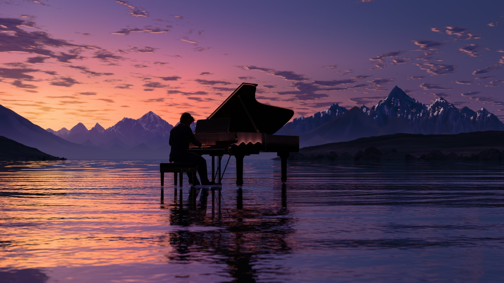
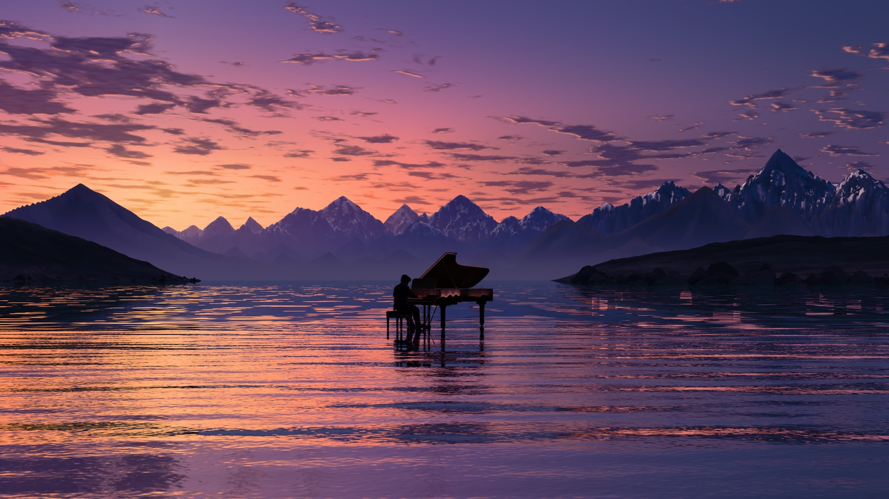
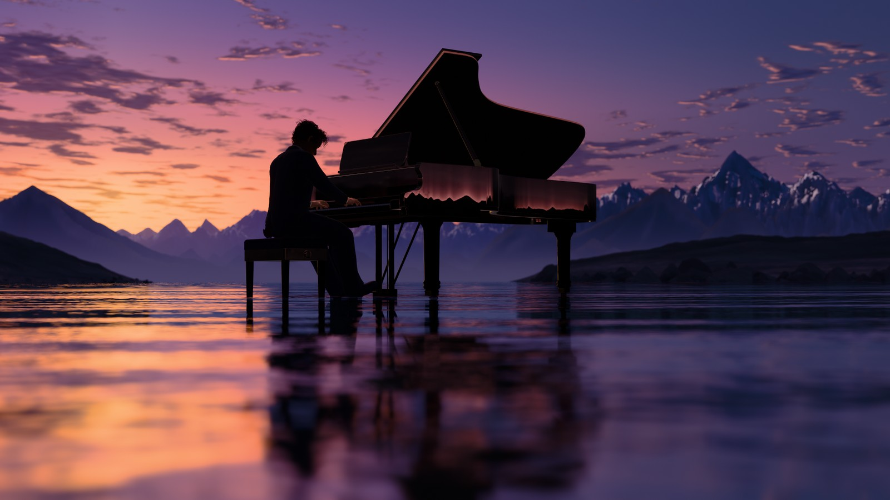
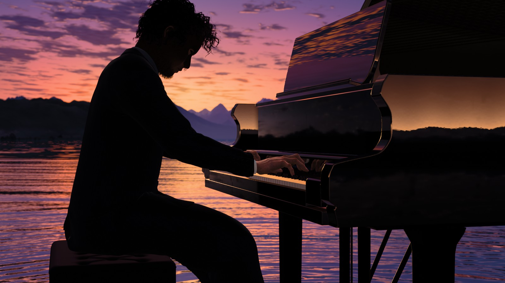
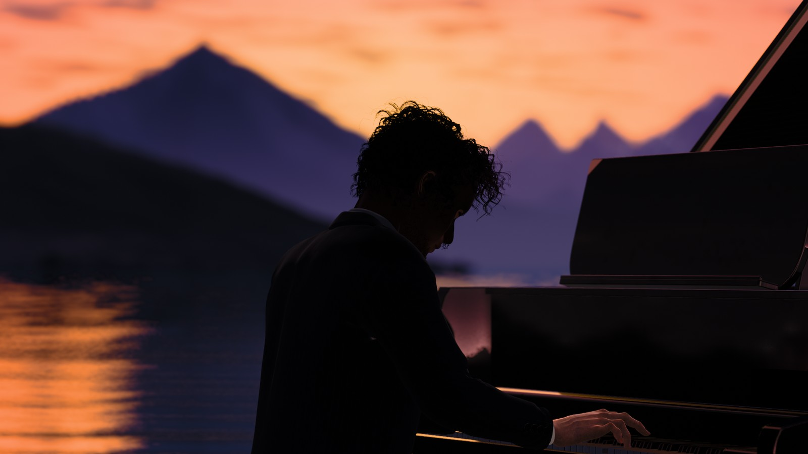
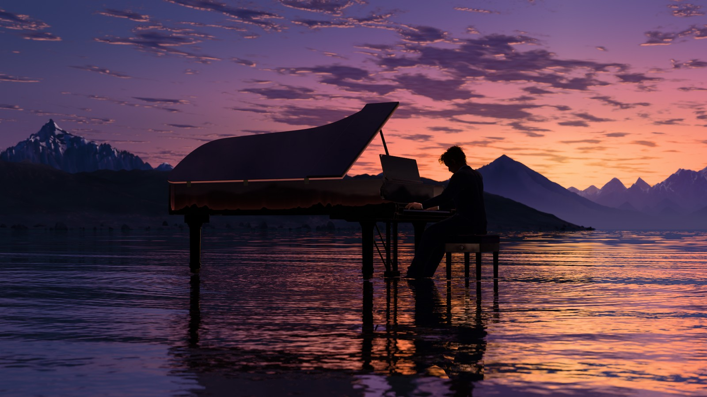
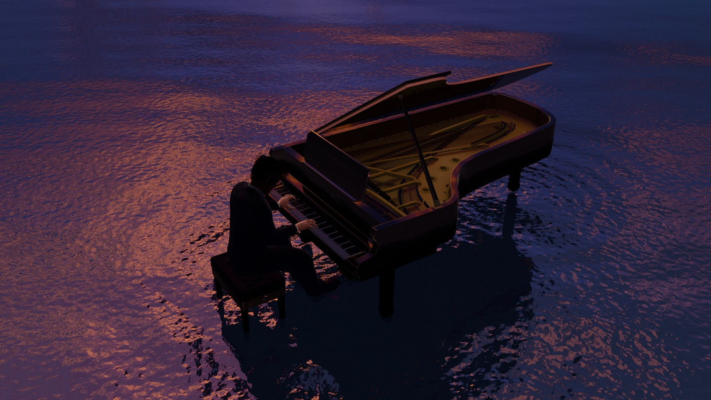
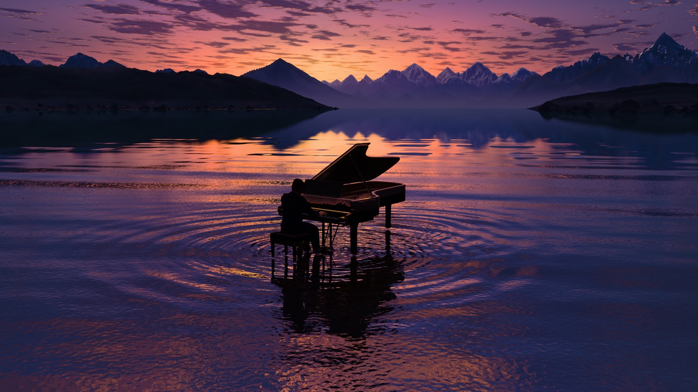
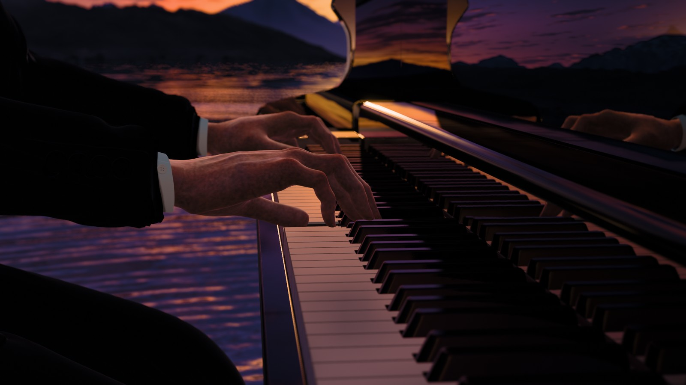
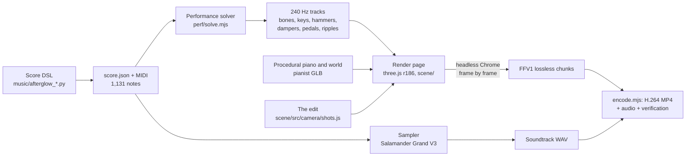

# Afterglow

**A pianist plays a concert grand standing in a shallow mountain lake at sunset: a 3:51 film rendered offline,
frame by frame, with three.js, set to an original piano piece.**

[](https://github.com/Leonxlnx/afterglow/releases/download/v1.0/afterglow_1080p60.mp4)

1920 x 1080, 60 fps, 13,857 frames. Every frame is the average of 16 to 128 sub-frames (motion blur, depth of field,
anti-aliasing) rendered on a laptop's integrated GPU. The music, the performance, the piano, the pianist, the sky,
the mountains and the water were all made for this film.

## Watch the film

- **[Afterglow, 1080p60 MP4 (H.264, AAC 320k, 668.3 MB)](https://github.com/Leonxlnx/afterglow/releases/download/v1.0/afterglow_1080p60.mp4)**
- A 1080p30 version for social media (`afterglow_x_1080p30.mp4`, every second frame of the film) is in the release
- All downloads, release notes and checksums: [release v1.0](https://github.com/Leonxlnx/afterglow/releases/tag/v1.0)

## Listen

The soundtrack on its own: "Afterglow", an original solo piano piece (E-flat major, a C-minor bridge, then up a whole
step to F major for the climax and the ending; 67 bars, 1,131 notes, 3:47).

- [WAV, 48 kHz / 24-bit (65.5 MB)](https://github.com/Leonxlnx/afterglow/releases/download/v1.0/afterglow.wav)
- [MP3, 320 kb/s (9.1 MB)](https://github.com/Leonxlnx/afterglow/releases/download/v1.0/afterglow.mp3)

The emotional pull of a slow ballad with a pop hook and a light hip-hop pocket in the choruses: intro, two verses
with pre-choruses and choruses, a contrasting bridge, a build into the climax, a tag, a two-bar memory of the verse
and a coda. Mastered to -16 LUFS, -1.2 dBTP.

## Stills

| | |
|---|---|
|  |  |
| *S01 Vista* | *S10 Water glide* |
|  |  |
| *S06 Macro hook* | *S15 Profile against the glow* |
|  |  |
| *S16 Lost profile* | *S17 Bass profile* |
|  |  |
| *S20 Drone rise* | *S23 Elevated vista* |
|  |  |
| *S24 Bare hand* | *S03 Hero* |

Stills from the final snapshot at the film's own settings (1920 x 1080, scaled to 1600 px for this page).

## How it was made



**1. The music.** The piece is written note by note in a small Python score DSL (`music/dsl.py`,
`music/afterglow_melody.py`, `afterglow_arr.py`, `afterglow_score.py`): melody, both hands' accompaniment, harmony
timeline, pedal plan, fingering hints, timing and dynamics shaping, plus validators (`afterglow_checks.py`). It
writes `music/final/score.json`, a MIDI file, a lead sheet and piano-roll sheets. Nothing is looped or generated from
patterns.

**2. The sound.** `music/sampler.py` is an offline sampler for the Salamander Grand Piano V3 set (a Yamaha C5, 16
velocity layers, 480 note samples plus release and pedal noises): every voice's attack is aligned to its note-on
(median error -0.02 ms), a damper model with a half-pedal zone follows the score's CC64, pedalled strings resonate,
and a synthetic true-stereo hall (RT60 1.8 s at 1 kHz) and a mastering chain (EQ, slow leveller, true-peak limiter)
finish the mix. The 3:47 render takes about 16 minutes.

**3. The performance.** `perf/solve.mjs` turns the score into the pianist's motion on the real rig: fingering by a
second-order Viterbi search with Parncutt's rules (the composer's fingers as constraints), one palm pose per onset
group solved by 6-DOF Levenberg-Marquardt against posture, anatomy, reach and mesh-collision terms, analytic finger IK
with the thumb as its own 4-DOF chain, two-bone arm IK with elbow swivel, phrase-driven body motion and breathing, the
right foot on the sustain pedal, and the keys, hammers, dampers and pedals of the piano itself. It writes 240 Hz tracks
(72 bones plus 88 keys, 88 hammers, 88 dampers and 3 pedals; 558 floats per sample) and the water-ripple events, and
checks them on the skinned mesh: fingertip contact error at key bottom p99 0.49 mm, no note played off its key.

**4. The piano.** A procedural D-class concert grand (2.74 x 1.56 m) built for extreme close-ups: case, lid and prop,
88 keys from ten shape classes, the full action with hammers and dampers, about 240 strings with wound bass strings,
the plate with struts, about 240 tuning pins with coiled wire, bridges, soundboard, legs, lyre, pedals and the bench.
Speaking lengths and strike points follow measurements of a real concert grand. 1.65 M triangles, 146 draw calls, built
in a few seconds in the page; no downloaded models or textures, no brand names. The lacquer is a clear-coat material with
an environment probe at the piano, plus planar mirrors on the music desk, the lid, the fallboard and the case arms.

**5. The pianist.** A MakeHuman base built headlessly in Blender with MPFB, bound in his seated playing pose: suit
cloth-simulated into that pose with 2.2 mm thick hems and seams, procedural curly hair and beard, about 14,000 hand
hairs, real nail plates, 3-D horn sleeve buttons, and a 6144 x 3072 hand texture set at about 9 texels per mm (wrinkles,
creases, tendons, veins). About 1 M triangles in a 24 MB GLB (meshopt + WebP, in Git LFS). His face is never lit from
the front; every frame of the edit is checked for it.

**6. The world.** Everything is procedural: a sky table fitted to the look of the references, an altocumulus layer
whose clumps rise into walls near the horizon, eroded mountain ranges and 820 fractured boulders (about 1.9 M terrain
triangles per sub-frame with their mirror copies), and the lake: a planar reflection per sub-frame, analytic
capillary-gravity ring packets (omega^2 = g k + (sigma / rho) k^3) launched by the performance's ripple events at the
piano's legs and the pedal foot, swell, chop and micro-normals, Fresnel, and a pebble bed 4 cm below the surface.

**7. The camera.** 26 shots, every cut anchored to a bar or beat of the score (a cut moves onto an anticipated push of
the music). Focus follows the hands from the solved performance. One evening: the sun sinks from -0.8 to -4.5 degrees
over the film, from afterglow to blue hour.

**8. The renderer.** An accumulation renderer on top of three.js: each output frame averages N sub-frames, each with
its own time inside a 180-degree shutter (true motion blur), its own pixel jitter and its own sample on a 9-blade
aperture (thin-lens depth of field, with a layered gap-fill pre-blur that scales with the circle of confusion). N is 32
per frame, 48 in three shots, and up to 128 on the 132 frames where a fast hand would otherwise show separate copies.
The release render uses these values up to 1:50 (frame 6,600, plus frames 6,900-7,199) and half of them after that
(16, 24 in the water shots, boosts halved), so that the render finished on one laptop.
The final pass is energy-conserving veiling glare (no threshold bloom), the Khronos PBR Neutral tone map, a custom
33^3 film LUT (one for close-ups, one for the wides and the blue hour) and TPDF dither.

**9. Offline and deterministic.** `render/render.mjs` drives headless Chrome with puppeteer-core. The page never runs
its own loop: Node asks for frame f, the page renders it from t = f / 60, and the pixels stream back into lossless
FFV1 chunks of 300 frames, each with a manifest that hashes every file the page loaded. Renders resume chunk by chunk.
The scene (the piano above all) keeps a little state from the frames before, so a chunk that starts a session first
renders and discards the three frames before it; with that, a frame rendered in another session, in another order, is bit-identical (checked
across three sessions).

**10. Encode and verification.** `render/encode.mjs` concatenates the chunks, encodes H.264 High (CRF 14, BT.709),
places the soundtrack after a 4 s lead-in, and verifies the result: every output frame against its own source frame
and its neighbours, compression PSNR, colour matrix and range, and the audio onset and cross-correlation lag.

### By the numbers

| | |
|---|---|
| Film | 230.95 s (3:51), 13,857 frames at 60 fps, 1920 x 1080, 26 shots |
| Sub-frames | 360,368 in the release render (26.0 per frame on average); 473,760 with full N throughout |
| Render | 21.8 h of wall-clock rendering for the 47 chunks on the shared laptop GPU, pauses for other GPU jobs included; about 9.7 h of it pure render time (median frame time per chunk); 23.7 GB of lossless FFV1 |
| Hardware | one laptop: AMD Ryzen 7 260, Radeon 780M integrated GPU, Windows 11, Chrome 155 headless (ANGLE / D3D11) |
| Lossless master | 47 FFV1 chunks |
| Sync | every key reaches bottom within one film frame of its note-on, which the sampler aligns with the audible onset (1,131 / 1,131 notes, from the tracks); in the rendered scene, 30 probed notes: fingertip on its key 30 / 30 (gap median 0.15 mm, max 0.63 mm), dampers 30 / 30; sustain pedal vs MIDI CC64 r = 1.000; right foot vs pedal r = -0.9995 |
| Audio vs picture | in the encode checks of the final film: audio onset error 0 ms, cross-correlation lag 0 at 7.7 s and at 170.4 s |
| Piano | 1.65 M triangles, 146 draw calls |
| Pianist | about 1 M triangles, 163-joint skeleton (72 animated bones), hands about 9 texels per mm |
| World | about 1.9 M terrain and boulder triangles per sub-frame; about 13.9 M triangles per sub-frame for the whole scene |
| Soundtrack | 227.5 s, 48 kHz / 24-bit, -16.0 LUFS integrated, -1.2 dBTP, loudness range 14.4 LU |

The detail behind every number (and the command that measured it) is in [`docs/`](docs/README.md).

### Made with Claude Code

Afterglow was made with [Claude Code](https://claude.com/claude-code) (Anthropic). Claude Code orchestrated the build
as multi-agent workflows, starting on 20 October 2026: research agents, builders for each module (render core, music, sampler,
world, piano, pianist, performance, camera), critics that scored each module against the reference images and the
brief, fix rounds, an integrator, a final review and the final render. The author set the brief, gave feedback on
stills and approved the song. The working documents those agents wrote are in [`docs/`](docs/README.md) and
[`research/`](research/).

## Rebuild it yourself

Tested on Windows 11 only, with the AMD Radeon 780M the render checks expect. You need Node.js 22+, Google Chrome,
FFmpeg 8 (with libx264 and libmp3lame) on the PATH, Python 3.11 and Git LFS.

```powershell
git lfs install
git clone https://github.com/Leonxlnx/afterglow.git afterglow
cd afterglow
npm ci                                                     # three 0.186.1, puppeteer-core 25.15.0
python -m venv .venv
.venv\Scripts\python -m pip install -r requirements.txt
```

**If Git LFS cannot download** (the repository's free LFS bandwidth is used up), the clone stops with an LFS error,
or `assets/pianist/pianist.glb` is a text pointer of about 130 bytes instead of a 24 MB binary. The two LFS files are
also attached to the release: clone without them, then put them at the same paths. Their sha256 in the release
notes is the `oid` in the pointer file.

```powershell
$env:GIT_LFS_SKIP_SMUDGE = '1'; git clone https://github.com/Leonxlnx/afterglow.git afterglow; Remove-Item Env:GIT_LFS_SKIP_SMUDGE
cd afterglow
curl.exe -L -o assets/pianist/pianist.glb https://github.com/Leonxlnx/afterglow/releases/download/v1.0/pianist.glb
curl.exe -L -o music/ir/detmold_konzerthaus_revc4_r2_stereo.wav https://github.com/Leonxlnx/afterglow/releases/download/v1.0/detmold_konzerthaus_revc4_r2_stereo.wav   # optional: the released mix does not use it
(Get-FileHash assets/pianist/pianist.glb).Hash                                 # compare with the release notes
```

**Soundtrack.** Download the Salamander Grand Piano V3 samples (48 kHz / 24-bit, 1.35 GiB, CC BY 3.0) and render the
mix (writes `build/audio/afterglow.wav`, `.mp3` and `afterglow_film.wav`, the same audio after a 4 s lead-in):

```powershell
curl.exe -L -o SalamanderGrandPianoV3_48khz24bit.tar.bz2 https://archive.org/download/SalamanderGrandPianoV3/SalamanderGrandPianoV3_48khz24bit.tar.bz2
mkdir music\samples\SalamanderGrandPianoV3
tar -xjf SalamanderGrandPianoV3_48khz24bit.tar.bz2 -C music\samples\SalamanderGrandPianoV3
.venv\Scripts\python music\render_audio.py                 # about 16 min
```

The score in `music/final/` is the frozen, approved version; `.venv\Scripts\python music\afterglow_score.py`
regenerates it from the note-by-note source.

**Performance.** Download the performance tracks of the film ([afterglow_perf_g1f.zip](https://github.com/Leonxlnx/afterglow/releases/download/v1.0/afterglow_perf_g1f.zip): `perf.json`,
`perf.bin`, `qc.json`) and unpack them into `build/anim/`. These are the exact tracks the film was rendered with; the
committed camera hand track and motion-blur table are keyed to them.

```powershell
Expand-Archive afterglow_perf_g1f.zip -DestinationPath build\anim
```

`node perf/solve.mjs` re-solves the performance from the score (about 20 min, plus about 25 min of QC). The solver code
went on to later experiments after the released run, so a fresh solve is not the film's run (docs/PERFORMANCE.md
section 8). After any new solve, freeze a snapshot, which re-solves the hand track and the motion-blur table for it,
and render from that snapshot: `node render/snapshot.mjs --out build/snap/mine` and `$env:AG_SERVE_ROOT =
"$PWD\build\snap\mine"`.

**Render.**

```powershell
$env:AG_GPU_ANY = '1'          # on any GPU other than the Radeon 780M the checks expect (never a software rasterizer)
$env:AG_CHROME = 'C:\path\to\chrome.exe'                   # only if Chrome is not in its default place
node render/selftest.mjs                                   # accumulation, glare, LUT, determinism, context loss
node render/still.mjs --frames 1519 --size 1080p --quality final --out build/stills/hero      # one still (S03)
node render/film.mjs plan   --preset final-1080p           # 13,857 frames, 473,760 sub-frames
node render/film.mjs render --preset final-1080p           # 47 FFV1 chunks in build/chunks/film_1080p; re-run to resume
node render/film.mjs render --preset final-1080p --verify  # re-hash every chunk against its manifest
node render/film.mjs encode --preset final-1080p           # build/out/afterglow_1080p60.mp4 + .verify.json
```

On the original machine the film projects to about 13.4 hours of rendering on an otherwise idle GPU, and the chunks
take about 24 GB. With the soundtrack WAV from the release instead of a local sampler render, encode with
`node render/encode.mjs --chunks build/chunks/film_1080p --from 0 --to 13857 --audio build/audio/afterglow.wav --out
build/out/afterglow_1080p60.mp4` (the plain WAV is placed at the 4 s offset by default).

On Windows, `render/lib/gpulock.mjs` keeps one GPU job at a time on the machine and pauses frames while another
headless GPU renderer is active (`AG_GPU_FOREIGN=0` turns that guard off); `AG_GPU_SHARED_LOCK=<file>` (or the first line of an
untracked `build/locks/shared-lock.path`) makes it also take another program's lock file (exclusive create, the holder's
pid as text). The interactive preview is
`node render/serve.mjs`, then `http://127.0.0.1:8137/scene/index.html?preview&frame=600&N=4&w=960&h=540`.

The pianist asset is committed (`assets/pianist/pianist.glb`). Rebuilding it needs Blender 5.2.2 with MPFB 2.0.18 and
the CC0 MakeHuman asset packs (`skins02`, `hands01`): set `AG_BLENDER` and `AG_MPFB_DATA`, then
`pwsh -File tools/pianist/run_all.ps1` (assets/pianist/README.md).

## Play a MIDI file

```powershell
npm run play -- path\to\song.mid      # or plain `npm run play`, then open or drop a file in the page
```

The player converts the file to a score (`player/midi.js`: tempo and meter map, CC64 sustain pedal, the hands split by
a Viterbi search, every note fingered by the solver), solves the performance with `perf/solve.mjs` and, beside it,
renders the sound with the film's sampler (`music/render_audio.py`, preset `final`, from the same score; one of each
at a time, resumed after a restart), then plays it in real time in the film's scene at N = 1 with preview bakes and an
automatic edit cut on the bars (`scene/src/camera/auto.js`, built from the film's own shots). The render needs the
Salamander samples and the Python packages of the Soundtrack step above (the player uses `.venv` when there is one, or
`AG_PYTHON`); without them the page plays a synthesised Web Audio piano (`player/synth.js`). Songs solved before the
samples were there get their render in the background. Solved songs are kept in `build/player/` and start at once.
The render size is the screen's, at most 1920 x 1080 (`?w=&h=` sets it). Space plays and pauses, the arrow keys
skip 5 s, F is fullscreen.

The hand split puts 98-99.5 % of the notes in the composer's hand on the four scores in `music/` and 89.5 % on
piano-midi.de's performance of Clair de lune, whose left-hand arpeggios climb past the right hand (the split gives their
tops to the free hand). The solve takes 8.3 min for 1,100 notes (3:48) and 11.5 min for Clair de lune (1,490 notes,
4:09), the audio render 74 s and 93 s; at 1280 x 720 the player draws 35-60 fps on an RTX 5070.

## Repository layout

```
scene/                 the film as a web page (ES modules, import map, no bundler)
  index.html           render page; exposes window.AG to the drivers
  src/core/            accumulation renderer, sample tables, thin lens, DOF gap-fill, glare, LUTs, final pass
  src/world/           sky, clouds, terrain, boulders, water, lake bed
  src/piano/           procedural D-class grand and bench, key / hammer / damper / pedal animation
  src/pianist/         pianist loader, skin / hair / cloth materials, tailoring, pose from the tracks
  src/camera/          shots.js (the edit), auto.js (an edit for any score), lenses, focus, sun arc, hand track
  src/integration/     wiring checks, per-shot looks, motion-blur N boost table, sync probe
  src/perf/            performance track reader
render/                Node drivers: still, chunked film render, encode + verify, snapshot, determinism, GPU lock
player/                real-time MIDI player: MIDI to score, solve queue and server, player page, Web Audio piano
perf/                  performance solver (timing, fingering, keyframes, IK, body, feet, keys, ripples) and QC
music/                 score DSL, the composition, sampler, mix; final/ = score.json, score.mid, lead sheet, rolls
  presets/, ir/        mix presets; an optional measured-hall impulse response (Git LFS, not used in the mix)
  candidates/          earlier composition candidates (melody, groove, arranger)
assets/pianist/        pianist.glb (Git LFS), rig.json, inspection and packing reports
tools/                 pianist build pipeline (Blender / MPFB scripts, textures, packing), piano generators and checks,
                       compare.py (reference comparison sheets)
sandbox/               only four helper scripts: the three render/snapshot.mjs runs and the composition sketch
                       whose score checks music/afterglow_score.py imports (the rest was a local working area)
docs/                  architecture, module documents, shot list, credits, README stills
research/              research notes behind each decision
analysis/              statistics measured on the reference images
```

Not in the repository: `build/` (everything generated: audio, tracks, chunks, films, snapshots), the reference images
(`refs/`, licence unknown), the downloaded samples (`music/samples/`), `node_modules/` and `.venv/`.

## Known limitations

Honest notes from the final review; none was fixable at parameter level before the final render.

- **S14, the one top-down shot (7.3 s), is the weakest.** From directly above, the hovering free fingers of both hands
  splay and curl and the left thumb points across at the right hand; the water around the bench shows hard-edged
  black blotches.
- **Thumbs and fingers.** Thumbs often stay stiff and stick out from the hand (pointer thumbs, most visible in the
  octave passages of the climax and in S02). Nine one-frame finger flicks above 12 degrees remain in readable hand
  shots; the worst sit inside motion blur. Fast right-hand leaps in S04 travel about 100 px per frame (smoothly blurred).
- **Nails.** In the S06 macro the nails read as dark red polish (light transmitted through the fingertip); it needs a
  look-development pass.
- **The far mountains** are a fairly uniform row of peaks with little layering; some ranges read as smooth pyramids,
  the clouds are smaller flecks than in the references, and the water in the wides is more mauve than warm orange.
- **S20 (drone rise)**: the water has a fine foil-like micro-pattern and lacks large peach cloud reflections.
  **S09**: the case side is darker than the sunset mirror it is meant to be. **S25 (blue hour)**: the white keys barely
  read and the open interior looks mustard-yellow.
- **Lacquer edges** draw thin dotted highlights that change from frame to frame (no specular anti-aliasing).
- **Banding**: the 8-bit H.264 shows faint one-code-value bands in smooth sunset skies; a 10-bit encode would remove
  them.
- **Details**: the shirt cuffs are about 2 cm wide and rather uniform; the shoe in the S11 foot shot is featureless;
  6 of 30 probed hammers peak a fraction of a degree short of the string (240 Hz sampling, not visible).
- **Render budget**: to fit the render window, the close-up shots were rendered at N = 32 instead of 48; an A/B of all
  capped shots showed only sampling-noise differences, indistinguishable by eye. From 1:50 on (except 1:55-2:00) the
  film was rendered at half N: a little more grain in defocused water, bokeh and glints. The switch points were
  compared frame by frame and show no visible step.
- **Reproducibility**: tested on one Windows machine and GPU; other GPUs and drivers will give slightly different
  pixels. The reference images are not included. Several development tools (look-dev harnesses, the critics' check
  scripts, the LUT fitter, the shot-list generator) lived in the local working area and are not part of the release;
  the files they produced are committed.

## Credits

- Piano samples: "Salamander Grand Piano V3" by Alexander Holm, CC BY 3.0
  (https://creativecommons.org/licenses/by/3.0/), https://archive.org/details/SalamanderGrandPianoV3; modified
  (re-imaged, onset-aligned, re-tuned, re-voiced and rendered by the Afterglow sampler).
- Pianist base mesh, rig, suit, shoes and skin texture: MakeHuman / MPFB community assets (Data Collection AB, Joel
  Palmius, Jonas Hauquier; Mindfront; jujube), CC0 1.0.
- Rendering: [three.js](https://threejs.org) (MIT); headless Chrome via puppeteer-core (Apache-2.0); FFmpeg as an
  external tool.

Everything else (composition, sampler, performance, piano, sky, mountains, water, camera, grade) was made for this
project. The full list, with every library and tool and its licence, is in [docs/CREDITS.md](docs/CREDITS.md).

## Licence

Code: MIT. The composition, the film, the audio renders and the stills: © 2026 Leonxlnx, all rights reserved.
The top of [LICENSE](LICENSE) states this scope; [docs/CREDITS.md](docs/CREDITS.md) carries the same table and the
third-party licences.

<!-- licence-scope: this block is identical in README.md and docs/CREDITS.md (publish.ps1 checks it) -->
| part | licence |
|---|---|
| The source code: `scene/`, `render/`, `perf/`, `tools/`; the Python code in `music/` (`dsl.py`, `afterglow_lib.py`, `afterglow_checks.py`, `sampler.py`, `render_audio.py`, `mix_meter.py`, and the candidates' helper modules `arranger/arr_tools.py`, `groove/analysis.py`, `groove/checks.py`, `groove/lib.py`, `melody/checks.py`, `melody/lib.py`); the helper scripts `sandbox/camera/handtrack.mjs`, `sandbox/camera/fk.mjs`, `sandbox/integration/blurstep.mjs`; the documentation (`README.md`, `docs/` except `docs/stills/`, `research/` except `research/music.md`, `analysis/`); the data the code generates and reads (the pianist GLB as a build, layouts, LUTs, camera and integration tables, mix presets, sampler calibration) | MIT (`LICENSE`) |
| The musical composition "Afterglow" and every file that encodes its notes: `music/afterglow_melody.py`, `music/afterglow_arr.py`, `music/afterglow_score.py`, `sandbox/music-research/sketch.py`, `research/music.md` (the composition brief: the chorus hook note by note, the chord charts with their voicings, the left-hand patterns); all of `music/final/` (`score.json`, `score.mid`, `leadsheet.txt`, `checks.txt`, `report.txt`, `roll_*.png`); the earlier versions in `music/candidates/`: `arranger/score.py`, `groove/score.py`, `groove/sec_a.py`, `sec_b.py`, `sec_c.py`, `sec_d.py`, `melody/score.py`, `melody/melodies.py`, `melody/chords.py`, `melody/arr.py`, and each candidate's `score.json`, `score.mid`, `leadsheet.txt`, `checks.txt`, `report.txt`, `roll_*.png`; the performance tracks (release asset `afterglow_perf_g1f.zip`: `perf.json`, `perf.bin`, `qc.json`), whose key, hammer and damper tracks encode the notes | © 2026 Leonxlnx, all rights reserved |
| The film and its renders: the film (`afterglow_1080p60.mp4`), the audio renders of the composition (the soundtrack `afterglow.wav` and `afterglow.mp3`) and the stills (`docs/stills/`) | © 2026 Leonxlnx, all rights reserved |
| Third-party assets: the Detmold impulse response in `music/ir/` (CC BY 4.0), the MakeHuman / MPFB parts of the pianist asset (CC0 1.0), the meshoptimizer decoder (MIT) and the others listed in `docs/CREDITS.md` | their own licences, as listed in `docs/CREDITS.md` |

A listed file is excluded from the MIT licence as a whole, including any code in it. The all-rights-reserved parts
are visible here for study: you may read them and rebuild the film and the soundtrack locally for your own study,
but no other right is granted (no copying, publishing, performing, recording or arranging of the music, and no
redistribution of the film, the audio or the stills).
<!-- /licence-scope -->
